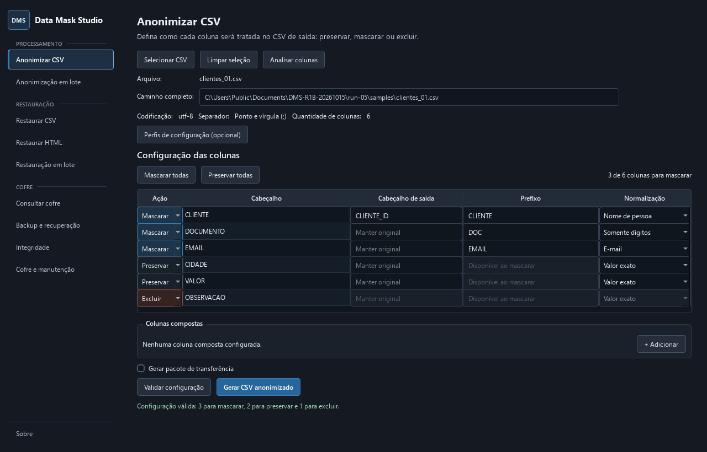
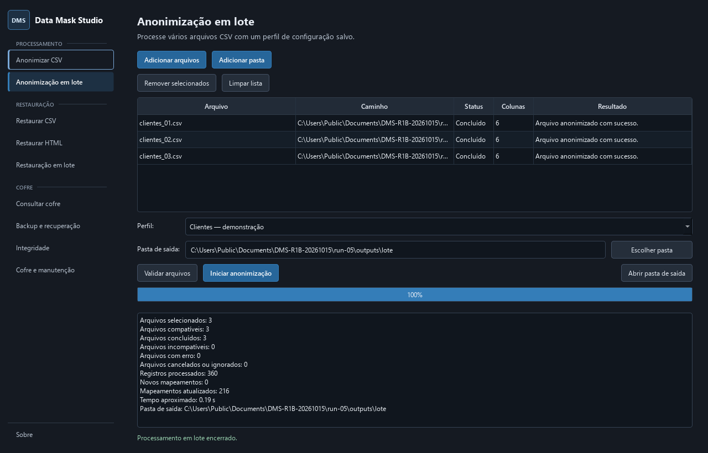
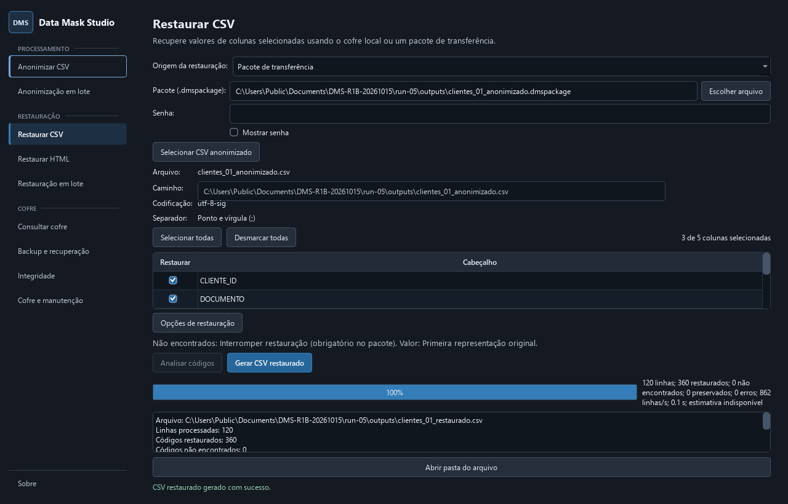

[English](README.md) | Português (Brasil)

<p align="center">
  
</p>

<h1 align="center">Data Mask Studio (DMS)</h1>

<p align="center">
  Preparação e mascaramento de dados open source para Windows, por Gustavo Wallace Macedo Santos.
</p>

<p align="center">
  <a href="https://github.com/Gustavo-Wallace/data-mask-studio/actions/workflows/tests.yml"></a>
  <a href="https://github.com/Gustavo-Wallace/data-mask-studio/releases/latest"></a>
  
  
  <a href="LICENSE"></a>
</p>

## Resumo

O Data Mask Studio é uma aplicação desktop local-first para preparação e tratamento de dados, anonimização e mascaramento determinístico, com restauração controlada por meio de um cofre local criptografado ou de um pacote seletivo criptografado de transferência. Os dados ficam locais; tokens individuais não contêm nem expõem diretamente o valor original.

A versão atual permite restaurar seletivamente CSVs mascarados e também códigos em arquivos HTML e dashboards locais.

A versão 1.3.0 está em preparação e ainda não foi publicada. O link de download abaixo aponta para a última release publicada.

Site oficial: https://gustavo-wallace.github.io/data-mask-studio/pt-br/

## Download da versão mais recente

[**Baixar a versão mais recente**](https://github.com/Gustavo-Wallace/data-mask-studio/releases/latest)

A release contém o instalador por usuário para Windows (`DataMaskStudio-Setup-<versão>.exe`) e o pacote portátil (`DataMaskStudio-Portable-<versão>.zip`). No pacote portátil, extraia toda a pasta antes de executar `DataMaskStudio.exe`.

## Captura da interface

<p align="center">
  <a href="docs/images/data-mask-studio-main.png"></a>
</p>

Prévia da futura 1.3.0, com dados sintéticos isolados e interface Windows em português. Abra uma imagem para ver os detalhes na resolução original.

<details>
<summary>Processamento em lote e restauração por pacote de transferência</summary>

Três CSVs sintéticos processados com sucesso usando um perfil salvo:

<a href="docs/images/data-mask-studio-batch.png"></a>

Restauração seletiva com o `.dmspackage` criptografado correspondente, com a senha limpa após a conclusão:

<a href="docs/images/data-mask-studio-package.png"></a>

</details>

## Principais recursos

- Preparação e mascaramento de CSV, individualmente ou em lote com perfis salvos.
- Preservar, mascarar ou excluir colunas; normalizar valores, renomear cabeçalhos de saída e compor colunas.
- Detecção assistida de colunas.
- Mascaramento determinístico com restauração pelo cofre ou por pacote seletivo.
- Pacotes de transferência criptografados (`.dmspackage`) opcionais, gerados junto ao CSV mascarado individual.
- Restauração de CSV e HTML.
- Cofre local criptografado.
- Backup completo do ambiente protegido por senha (`.dmsbackup`).
- Auditoria de integridade, diagnóstico e manutenção.
- Processamento em fluxo para arquivos grandes.
- Operação local sem telemetria.

## Instalação

No instalador, execute o arquivo Setup e siga o assistente. A instalação é feita por usuário. Na versão portátil, extraia o ZIP em uma pasta nova e execute `DataMaskStudio.exe`.

## Fluxo básico

1. Selecione um CSV e escolha as colunas que serão mascaradas.
2. Configure prefixos e normalizações e valide a configuração.
3. Gere o CSV mascarado, opcionalmente com um pacote de transferência protegido por senha, ou utilize um perfil no processamento em lote.
4. Para recuperar dados tabulares, use a aba “Restaurar CSV” com o cofre local ou com o pacote correspondente e sua senha.
5. Para arquivos HTML e dashboards locais, use a aba “Restaurar HTML” com o cofre local.
6. Consulte códigos específicos pelo consultor local quando necessário.

## Segurança e privacidade

O processamento ocorre localmente; arquivos e dados não são enviados automaticamente. As chaves locais são protegidas pelo Windows DPAPI. Consulte a [política de segurança](SECURITY.md) e a [política de privacidade](PRIVACY.md). Isso não representa garantia de segurança absoluta.

O mascaramento determinístico é pseudonimização, não anonimização irreversível. Trate pacotes de transferência e backups como sensíveis: suas senhas permitem recuperar os dados incluídos. A criptografia de pacotes e backups usa AES-256-GCM com chaves derivadas de senha.

Os executáveis ainda não possuem assinatura digital, portanto o Windows pode apresentar um aviso do SmartScreen.

## Arquitetura resumida

A interface desktop em PySide6 coordena serviços separados de processamento de CSV e HTML, perfis, backups e manutenção do cofre. Os mapeamentos sensíveis são protegidos em um cofre SQLite local com AES-256-GCM, enquanto as chaves locais são protegidas pelo Windows DPAPI. Os fluxos de processamento usam memória limitada e publicam arquivos gerados de forma atômica.

## Compatibilidade e recuperação

A preparação da 1.3.0 mantém o schema 4 do cofre e os formatos existentes dos tokens. Cofres antigos suportados são migrados usando as chaves originais. Consulte [COMPATIBILITY.md](COMPATIBILITY.md) para os limites dos formatos e as orientações de recuperação.

- **Cofre local:** a restauração exige o cofre e suas chaves locais originais, protegidas pelo Windows DPAPI.
- **Pacote seletivo de transferência:** contém apenas os mapeamentos de restauração do CSV vinculado, não o ambiente completo. O destinatário precisa do CSV mascarado sem alterações, do `.dmspackage`, da senha e de uma versão do DMS com suporte ao formato v1 do pacote; não precisa do cofre nem das chaves DPAPI do remetente. A criação exige ao menos uma ação Mascarar e senha de no mínimo 8 caracteres. Mapeamentos ausentes interrompem a restauração; não há fallback para o cofre local.
- **Backup completo do ambiente:** o `.dmsbackup` contém as chaves locais, o cofre e os perfis salvos quando presentes, não arquivos CSV ou HTML. Usa uma política separada de senha (mínimo de 12 caracteres) e restaura o ambiente local, não valores selecionados de um CSV.

## Execução pelo código-fonte

No Windows PowerShell:

```powershell
git clone https://github.com/Gustavo-Wallace/data-mask-studio.git
cd data-mask-studio
python -m venv .venv
.venv\Scripts\Activate.ps1
python -m pip install --upgrade pip
python -m pip install -e .
python -m data_mask_studio
```

## Limitações

- A distribuição atual é destinada ao Windows por depender do Windows DPAPI.
- A geração e a restauração de pacotes estão disponíveis para CSVs individuais, não para HTML ou operações em lote. Os pacotes exigem os mesmos bytes do CSV vinculado e têm limite padrão de 64 MiB de payload descriptografado.
- Não há sincronização, telemetria, atualização automática ou recuperação remota de chaves.
- Os executáveis não possuem assinatura digital.

## Documentação

- [Histórico de alterações](CHANGELOG.md)
- [Política de segurança](SECURITY.md)
- [Política de privacidade](PRIVACY.md)
- [Compatibilidade e recuperação](COMPATIBILITY.md)

## Licença

O Data Mask Studio é distribuído sob a [GNU General Public License v3.0 only](LICENSE) (`GPL-3.0-only`). Componentes de terceiros permanecem sujeitos às suas próprias licenças.

Criado por Gustavo Wallace Macedo Santos.

Copyright © 2026 Gustavo Wallace Macedo Santos
